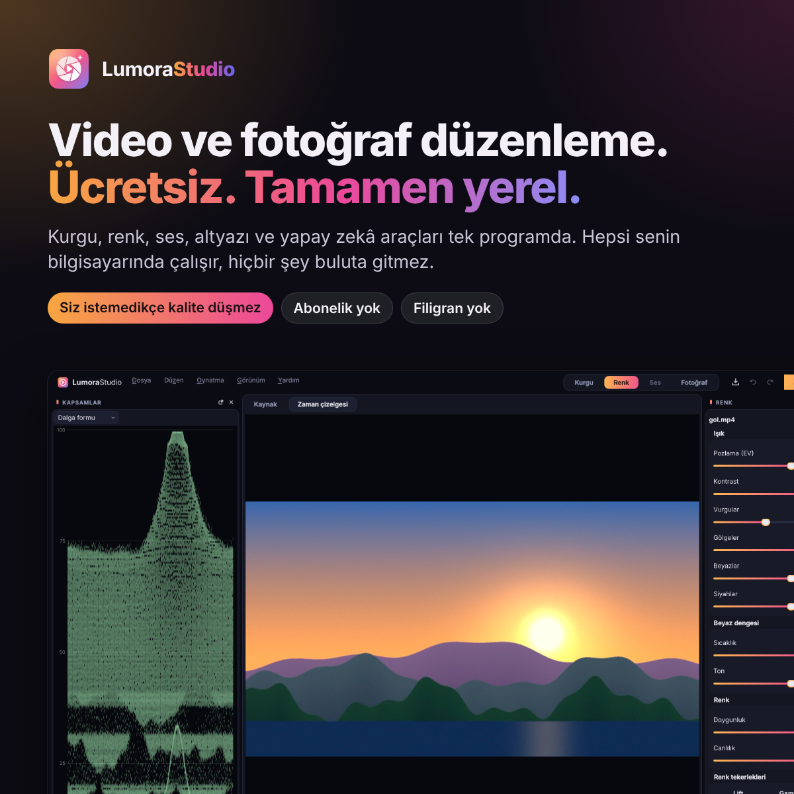
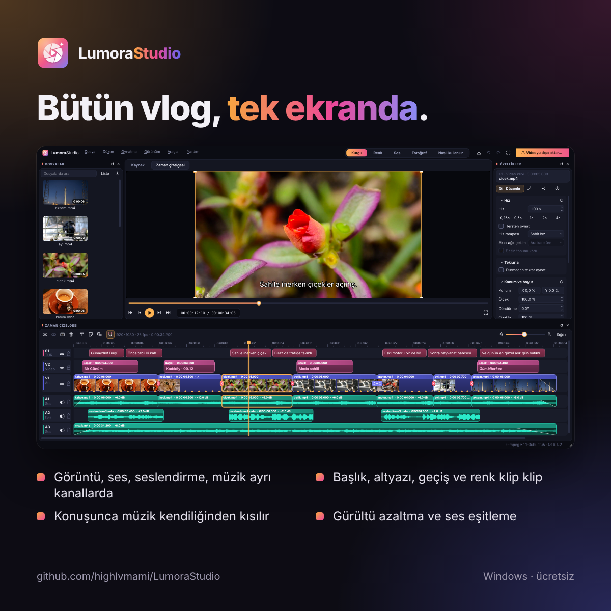
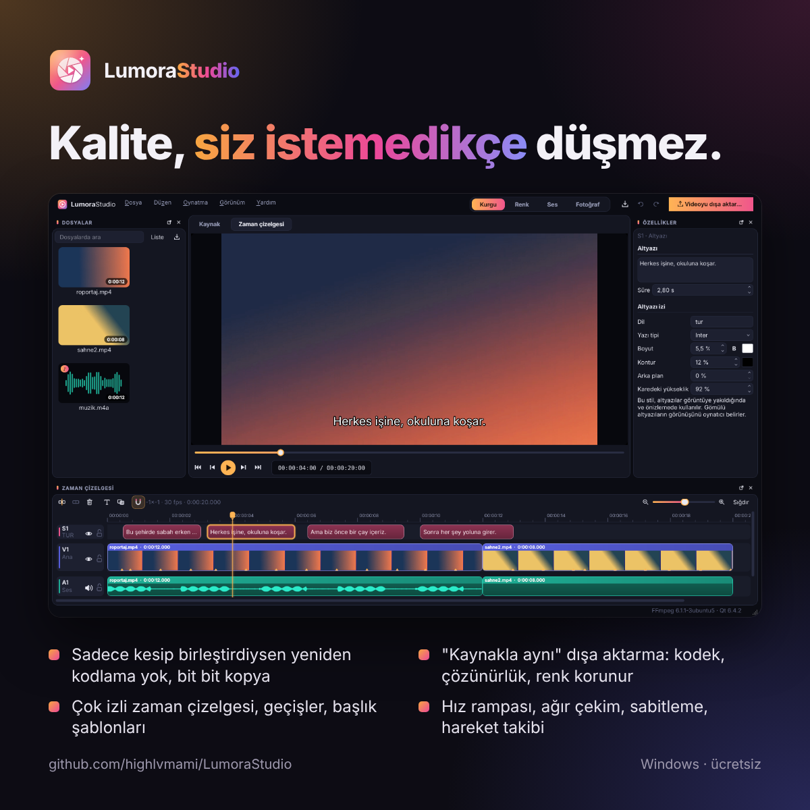
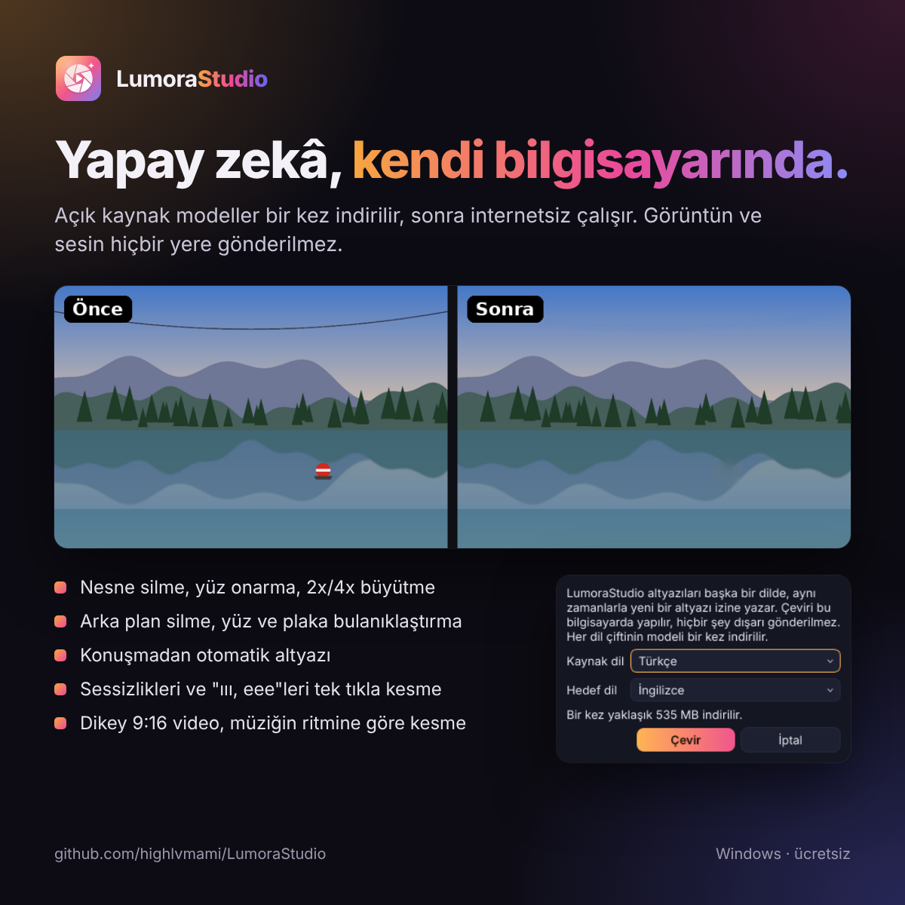
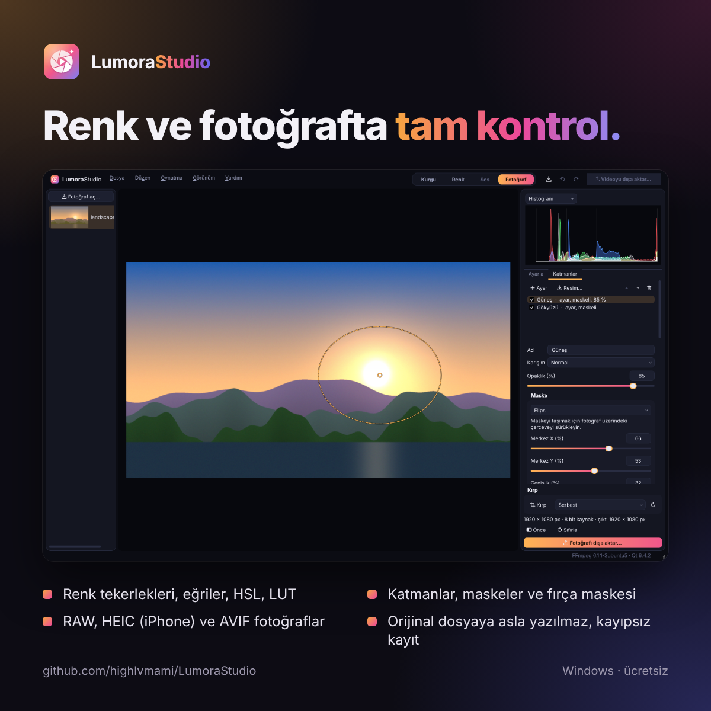
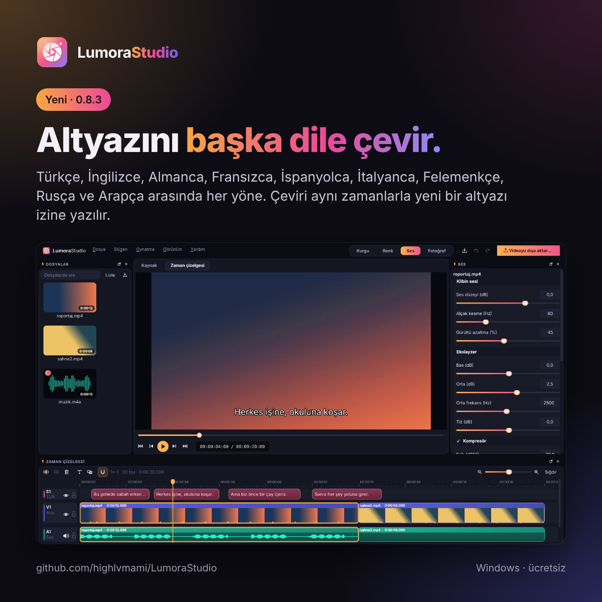

# LumoraStudio

Ücretsiz, tamamen yerel çalışan bir video ve fotoğraf düzenleyici. İlk kuralı şu: **siz istemedikçe kalite asla düşmez.**

- Sadece kesip birleştirdiyseniz video yeniden kodlanmaz; paketler bit bit kopyalanır.
- Yeniden kodlamak gerekiyorsa "kaynakla aynı" seçeneği kodek, çözünürlük, kare hızı, bit derinliği, renk ve bit hızını kaynaktan alır.
- Fotoğraflarda orijinal dosyaya asla yazılmaz; ayarlar projede saklanır, dışa aktarırken 32 bit kayan noktada hesaplanıp kayıpsız kaydedilir.

<p align="center">
  
  
</p>

Bir vlog kurgusu, kurgu çalışma alanında: görüntü, kamera sesi, seslendirme ve müzik ayrı kanallarda; başlıklar, altyazılar, geçişler ve renk ayarı klip klip.


<p align="center">
  
  
</p>
<p align="center">
  
  
</p>

Açık tema ("Gündüz", Görünüm → Tema):


Tam yol haritası: [docs/ozellikler.md](docs/ozellikler.md). Mimari: [docs/mimari.md](docs/mimari.md).

## Sürüm 0.8.3: altyazı çevirisi

- **Düzen → Altyazılar → Altyazıları çevir…**: bir altyazı izini seçtiğin dile çevirir ve aynı zamanlarla yeni bir altyazı izine yazar. Biçimi (yazı boyu, yer, kutu) kopyalanır; asıl iz olduğu gibi kalır.
- Türkçe, İngilizce, Almanca, Fransızca, İspanyolca, İtalyanca, Felemenkçe, Rusça ve Arapça arasında her yöne. İki dil arasında doğrudan model yoksa İngilizce üzerinden çevrilir.
- Çeviri bu bilgisayarda yapılır (Helsinki Üniversitesi'nin Opus-MT modelleri; Türkçe için daha büyük ve daha iyi "tc-big" modeller), hiçbir şey dışarı gönderilmez. Her dil çiftinin modeli ilk kullanımda bir kez indirilir (Türkçe→İngilizce ve İngilizce→Türkçe yaklaşık 535 MB, diğerleri yaklaşık 110 MB).

Önceki sürümlerin notları: [Releases](https://github.com/highlvmami/LumoraStudio/releases).

## Klavye kısayolları

| Tuş | İşlem |
|---|---|
| Boşluk | Oynat / duraklat |
| ← / → | Önceki / sonraki kare |
| Home / End | Başa / sona git |
| I / O | Giriş / çıkış noktası |
| E | Kaynak aralığını zaman çizelgesine ekle |
| T | Oynatma kafasına başlık ekle |
| Ctrl+T | Seçili klibe ya da en yakın kesime geçiş ekle |
| Ctrl+Alt+S | Geçerli kareyi dışa aktar |
| S veya Ctrl+B | Oynatma kafasından böl |
| Del | Klibi sil (boşluğu kapat) |
| Ctrl+J | Sonraki kliple birleştir |
| N | Yapışmayı aç/kapat |
| + / − | Yakınlaştır / uzaklaştır |
| Ctrl+I / Ctrl+E | Medya içe aktar / videoyu dışa aktar |
| Ctrl+Z / Ctrl+Shift+Z | Geri al / yinele |
| C / \\ | Fotoğrafta kırpma / önce-sonra |

## Derleme

Gerekenler:

- CMake 3.21+, C++20 derleyici (Windows'ta Visual Studio 2022, Linux'ta GCC 11+ ya da Clang 14+)
- Qt 6.4+ : Core, Gui, Widgets, Concurrent, Multimedia, LinguistTools (testler için Test). WebP/TIFF için Qt Image Formats eklentisi önerilir.
- FFmpeg 6.1 – 8.x kütüphaneleri: avformat, avcodec, avutil, swscale, swresample

### Windows

1. **Visual Studio 2022**'yi "Desktop development with C++" iş yüküyle kurun (CMake ve Ninja onunla gelir).
2. **Qt 6**'yı kurun. [Qt Online Installer](https://www.qt.io/download-qt-installer-oss) ile *Qt 6.8 → MSVC 2022 64-bit* ve *Additional Libraries → Qt Multimedia, Qt Image Formats* seçin. Ya da komut satırından:
   ```powershell
   pip install aqtinstall
   aqt install-qt windows desktop 6.8.3 win64_msvc2022_64 -m qtmultimedia qtimageformats -O C:\Qt
   ```
3. **FFmpeg**'i indirin: [BtbN FFmpeg-Builds](https://github.com/BtbN/FFmpeg-Builds/releases/tag/latest) sayfasından `ffmpeg-n8.1-latest-win64-gpl-shared-8.1.zip` dosyasını alıp örneğin `C:\deps\ffmpeg` klasörüne açın (`include`, `lib`, `bin` klasörleri orada olmalı).
4. İsteğe bağlı, RAW fotoğraflar için **LibRaw**: [vcpkg](https://vcpkg.io) ile `vcpkg install libraw:x64-windows`, sonra aşağıdaki `cmake` satırına `-DCMAKE_TOOLCHAIN_FILE=C:\vcpkg\scripts\buildsystems\vcpkg.cmake` ekleyin ve `C:\vcpkg\installed\x64-windows\bin` içindeki DLL'leri programın yanına koyun. LibRaw olmadan da derlenir; yalnızca RAW dosyaları açılmaz.
5. "x64 Native Tools Command Prompt for VS 2022" penceresinde:
   ```bat
   git clone https://github.com/highlvmami/LumoraStudio.git
   cd LumoraStudio
   cmake -S . -B build -G Ninja -DCMAKE_BUILD_TYPE=Release ^
         -DCMAKE_PREFIX_PATH=C:\Qt\6.8.3\msvc2022_64 -DFFMPEG_ROOT=C:\deps\ffmpeg
   cmake --build build
   ```
   Derleme sonunda FFmpeg DLL'leri otomatik olarak `build\src\app` içine kopyalanır.
6. Çalıştırmak ya da başka bir bilgisayara taşımak için Qt DLL'lerini yanına koyun:
   ```bat
   C:\Qt\6.8.3\msvc2022_64\bin\windeployqt.exe --release build\src\app\LumoraStudio.exe
   build\src\app\LumoraStudio.exe
   ```

Hazır derlenmiş paket: her PR ve `main` için GitHub Actions'ta **Build** iş akışı çalışır; `LumoraStudio-windows-x64` çıktısını indirip açtığınızda `LumoraStudio.exe` doğrudan çalışır.

### Linux (Ubuntu 24.04)

```bash
sudo apt install build-essential cmake ninja-build pkg-config \
  qt6-base-dev qt6-multimedia-dev qt6-tools-dev qt6-tools-dev-tools qt6-l10n-tools \
  qt6-image-formats-plugins libgl-dev \
  libavformat-dev libavcodec-dev libavutil-dev libswscale-dev libswresample-dev \
  libraw-dev
cmake -S . -B build -G Ninja -DCMAKE_BUILD_TYPE=Release
cmake --build build
./build/src/app/LumoraStudio
```

Başka bir FFmpeg kullanmak için `-DFFMPEG_ROOT=/yol/ffmpeg` verin; verilmezse pkg-config kullanılır. LibRaw isteğe bağlıdır: yoksa program yine derlenir, yalnızca RAW dosyaları listelenmez.

### macOS

Kod taşınabilir yazıldı ama 0.1'de macOS derlemesi denenmedi. `brew install qt ffmpeg cmake ninja` sonrasında Linux'taki komutlar çalışmalıdır.

## Çalıştırma

```bash
LumoraStudio                     # boş proje
LumoraStudio proje.lumora        # proje aç
LumoraStudio video.mp4 foto.jpg  # dosyaları içe aktararak başla
```

Dil, Görünüm → Dil menüsünden seçilir (yeniden başlatınca geçerli olur); seçilmezse sistem dili kullanılır.

## Testler

```bash
cmake --build build
QT_QPA_PLATFORM=offscreen ctest --test-dir build --output-on-failure
```

Testler kendi deneme videolarını üretir (her kare kendi numarasını taşır) ve şunları doğrular: kayıpsız kesimde paketlerin bit bit aynı olması, "kaynakla aynı"da kare hassasiyeti, FFV1'de piksel piksel eşitlik, B-kareli H.264 kesimlerinde hiç çözme hatası olmaması, zaman çizelgesi işlemleri, fotoğraf işleme ve proje dosyasının gidiş-dönüşü. 0.2 ile eklenenler: başlık, geçiş ve karıştırılmış sesli zaman çizelgesinin işlenmesi, özel ayarlarda her karenin korunması, ölçekleme ve kare hızı değişimi, bit hızı modlarının hedefi tutturması, ProRes/DNxHR çıktısı, her hazır ayarın planlanabilmesi ve diğer kodlayıcıların tek ve iki geçişte çalışması. 0.3 ile eklenenler: renk ayarlarının her birinin doğru aralığa etki etmesi, .cube okuma (3B/1B, hatalı dosyalar) ve yazma, kaydedilen LUT'un aynı görünümü vermesi, kapsamlar, maskeli ayar katmanları ve resim katmanlarında karışım modları, klip renginin önizlemede ve dışa aktarmada aynı işlenmesi. 0.4 ile eklenenler: EBU referans tonlarıyla ses yüksekliği ölçümü, limitleyicinin tavanı hiç aşmaması, gürültü azaltmanın sinyale dokunmayıp gürültüyü düşürmesi ve gecikmesinin tam olması, ekolayzer, kısma, eşitlemenin hedefi tutturması, ses efektleriyle dışa aktarmada görüntünün bit bit kopyalanması, altyazının gömülmesi/yakılması/.srt olarak kaydedilmesi, SRT/VTT okuma-yazma, eğriler, HSL, fırça maskesi ve RAW (üretilen bir DNG ile) açma. 0.6 ile eklenenler: yüz/plaka bölgelerinin kareler arasında doğru doldurulması ve proje dosyasında korunması, takipçinin kareden kareye eşleştirmesi (kısa kayıplar dahil), bulanıklaştırma/pikselleştirme/siyah kutunun bölge dışına dokunmaması, çizicinin bölgeleri önizlemede ve dışa aktarmada aynı gizlemesi, saydamlık maskesi; modeller varken (`LUMORA_VISION_MODELS`) gerçek bir fotoğrafta ve hareket eden bir videoda yüz bulma, plaka bulma ve arka plan kaldırma.

## Proje yapısı

```
src/core/        Arayüzden bağımsız çekirdek (lumora_core kütüphanesi)
  TimeBase.*       Tamsayı zaman tabanı (1/705 600 000 sn), kare hızı yardımcıları
  ffmpeg/          FFmpeg için RAII sarmalayıcılar
  media/           Medya bilgisi, anahtar kare taraması, video/ses çözücüler, medya havuzu
  timeline/        Zaman çizelgesi modeli (izler, klipler, bağlantılar, başlık/geçiş/dönüşüm ayarları), SRT/VTT altyazı okuma/yazma
  render/          Kare birleştirici (FrameRenderer), başlık çizici, ses karıştırıcı
  audio/           Ses efektleri (filtreler, gürültü azaltma, kompresör, limitleyici), EBU R128 ses yüksekliği ölçümü
  color/           Renk ayarları (ColorGrade, eğriler, HSL), renk hattı (ColorProcessor), .cube LUT okuma/yazma, kapsamlar
  undo/            Geri al / yinele komutları
  export/          Dışa aktarma planlayıcı (ne kopyalanır, ne kodlanır), kodlayıcı tablosu ve hazır ayarlar, kopyalayan ve işleyen dışa aktarıcılar
  ai/              Yerel yapay zeka: Whisper konuşma tanıma, ONNX Runtime ile yüz/plaka bulma ve takip, arka plan kaldırma
  motion/          Hareket analizi: sabitleme ve nesne takibi
  image/           Fotoğraf ayarları ve katmanları, işleme hattı, fotoğraf kütüphanesi, RAW okuyucu (LibRaw)
  project/         .lumora proje dosyası
src/app/         Qt Widgets arayüzü: ana pencere, paneller, oynatma motoru, pencereler
src/i18n/        Çeviriler (lumora_tr.ts)
tests/           Qt Test birim testleri
docs/            Özellik listesi, mimari, ekran görüntüleri
```

Çeviriyi güncellemek için: `cmake --build build --target update_translations`, sonra `src/i18n/lumora_tr.ts` dosyasını Qt Linguist ile düzenleyin.

## Lisans notu

Yapay zeka araçları ONNX Runtime (MIT) ile çalışır; Windows paketinde onnxruntime.dll olarak gelir. Modeller programla dağıtılmaz, ilk kullanımda kendi yayınlandıkları yerden indirilir (lisansları yukarıda).

Arayüzde kullanılan Inter yazı tipi programın içine gömülüdür ve SIL Open Font License 1.1 ile dağıtılır (`src/app/resources/fonts/OFL.txt`).

Henüz bir lisans dosyası eklenmedi; projenin lisansına siz karar vermelisiniz. Windows paketi BtbN'in GPL FFmpeg derlemesini kullanır (x264 vb. içerir), bu yüzden dağıtılan paket GPL koşullarına tabidir. LGPL istenirse `lgpl-shared` derlemesi kullanılabilir; o durumda H.264 kodlama için başka bir kodlayıcı gerekir.
