# LumoraStudio

Ücretsiz, tamamen yerel çalışan bir video ve fotoğraf düzenleyici. İlk kuralı şu: **siz istemedikçe kalite asla düşmez.**

- Sadece kesip birleştirdiyseniz video yeniden kodlanmaz; paketler bit bit kopyalanır.
- Yeniden kodlamak gerekiyorsa "kaynakla aynı" seçeneği kodek, çözünürlük, kare hızı, bit derinliği, renk ve bit hızını kaynaktan alır.
- Fotoğraflarda orijinal dosyaya asla yazılmaz; ayarlar projede saklanır, dışa aktarırken 32 bit kayan noktada hesaplanıp kayıpsız kaydedilir.

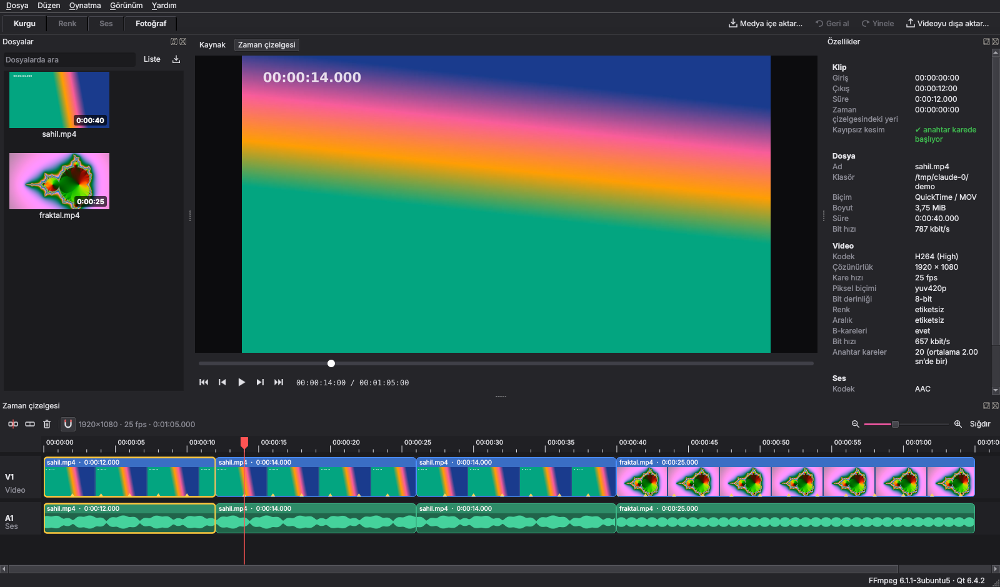

| Renk | Fotoğraf katmanları |
|---|---|
| 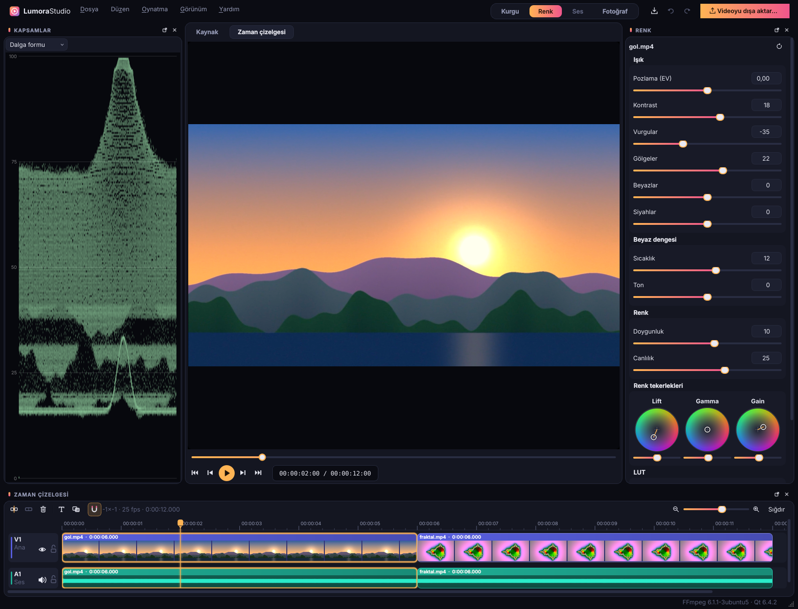 | 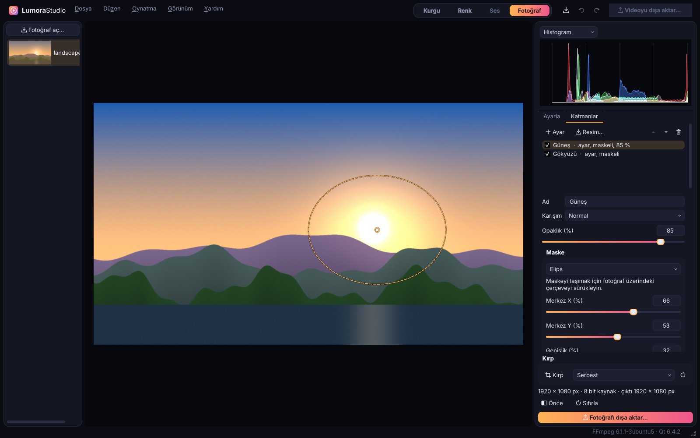 |

| Dışa aktarma | Fotoğraf |
|---|---|
| 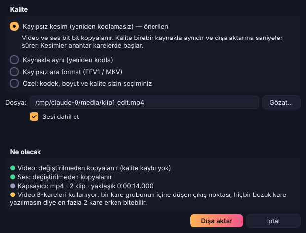 | 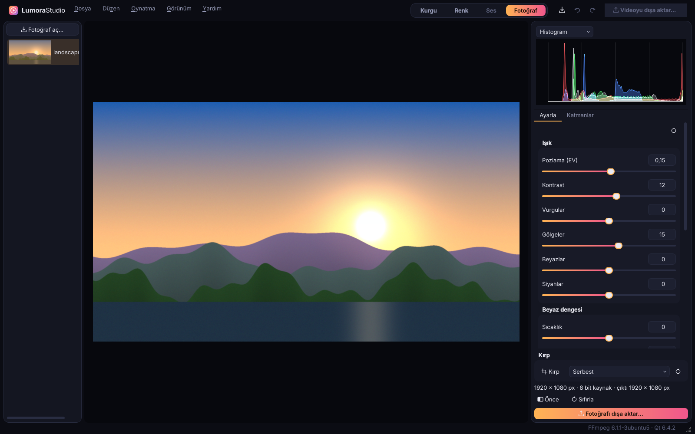 |

Açık tema ("Gündüz", Görünüm → Tema):

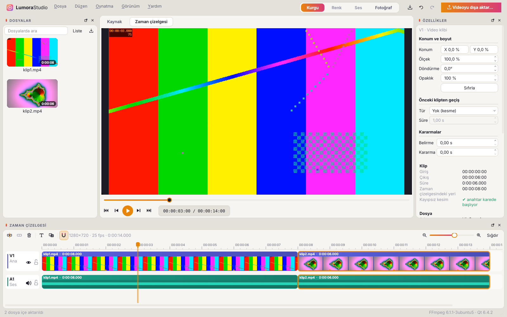

Tam yol haritası: [docs/ozellikler.md](docs/ozellikler.md). Mimari: [docs/mimari.md](docs/mimari.md).

## Sürüm 0.6'da neler var

Yapay zeka araçlarının ilk dilimi. Hepsi bu bilgisayarda çalışır (ONNX Runtime, işlemci üzerinde); hiçbir görüntü dışarı gönderilmez. Her model ilk kullanıldığında bir kez indirilir.

**Yüz ve plaka bulanıklaştırma (otomatik takip ile)**
- Video klibi seçin, Özellikler panelinde **Yüzleri ve plakaları gizle → Yüzleri ve plakaları bul**. Klip kare kare taranır, her yüz ve araç plakası bulunup hareket ettikçe takip edilir; kısa süre kaybolan (dönen, bulanıklaşan) bir yüzün arası doldurulur.
- **Görünüm:** bulanıklaştır, pikselleştir ya da siyah kutu; **Güç** ne kadar iri olacağını ayarlar. Yüzler elips, plakalar dikdörtgen kapatılır.
- Bulunan her yüz ve plaka listede ayrı bir satırdır; görünür kalması gerekeni (örneğin röportaj yapılan kişi) işaretini kaldırarak açın. Yüzler ve plakalar ayrı ayrı da kapatılabilir.
- Bölgeler projede saklanır, çizim sırasında model çalışmaz: önizleme ve dışa aktarma aynı sonucu verir. Klip sonradan uzatılırsa panel yeniden aramayı önerir.
- Fotoğrafta da aynısı: Fotoğraf çalışma alanında yeni **Akıllı** sekmesi. Büyük fotoğraflar parçalara bölünerek taranır, küçük yüzler de bulunur.

**Arka planı kaldırma**
- Video klibinde **Arka plan → Arka planı kaldır**: kişi ya da nesne her karede arka plandan ayrılır, gerisi saydam olur. Klibi bir üst ize (V2) koyarsanız alttaki klip arkada görünür. **Hızlı** (U²-Net, 5 MB) ya da **Ayrıntılı** (IS-Net, 179 MB, saç ve ince kenarlarda daha iyi) model, **Kenar yumuşaklığı** ayarı. Önizleme her zaman hızlı modeli kullanır, dışa aktarma seçileni.
- Fotoğrafta **Akıllı → Arka planı kaldır**; saydam kısımlar dama deseni üzerinde gösterilir. PNG, TIFF ve WebP saydamlığı korur; JPEG'de konu beyaz zemine konur.

Modeller: yüz için YuNet (OpenCV Zoo, MIT), plaka için YOLOv9-t (open-image-models, MIT), arka plan için U²-Net (Apache 2.0) ve IS-Net (Apache 2.0).

## Sürüm 0.5'te neler var


**Görüntü sabitleme**
- Video klibi seçin, Özellikler panelinde **Sabitleme → Titreyen kamerayı sabitle**. Kamera hareketi bir kez ölçülür (köşe noktaları kareden kareye izlenir), sonra her kare yumuşatılmış bir yola oturtulur.
- **Yumuşatma** ne kadar sarsıntının giderileceğini, **Yakınlaştırma** kenarların kadraj dışında kalması için gereken büyütmeyi ayarlar; yakınlaştırma yumuşatmaya göre kendiliğinden hesaplanır. Yeniden ölçmeden değiştirilebilir, geri alınabilir.

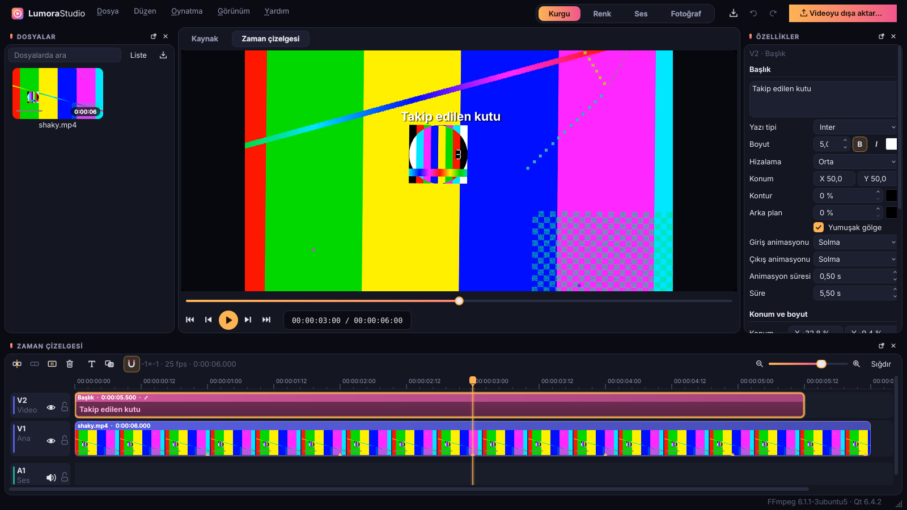

**Hareket takibi**
- Bir başlık ya da üst izdeki bir klip seçin, **Hareket takibi → Bir nesneyi takip et…** deyin ve önizlemede nesnenin çevresine bir kutu çizin. Klip, ana izdeki görüntüde o nesneyle birlikte hareket eder (örneğin bir kişinin üstündeki isim).
- Takip ekranda görünen görüntü üzerinde yapılır; dönüşümler, geçişler ve sabitleme hesaba katılır. Küçük hatalar nesnenin görünüşüne göre düzeltildiği için kareden kareye birikmez.

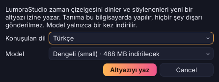

**Otomatik altyazı (Whisper, tamamen yerel)**
- **Düzen → Altyazılar → Konuşmadan otomatik altyazı…**: zaman çizelgesindeki ses dinlenir, söylenenler yeni bir altyazı izine satır satır yazılır. Türkçe varsayılan; İngilizce, Almanca, Fransızca, İspanyolca, Arapça, Rusça ya da otomatik dil bulma da var.
- Tanıma bu bilgisayarda yapılır, hiçbir şey dışarı gönderilmez. Model (hızlı / dengeli / en doğru) ilk kullanımda bir kez indirilir.
- Yazılan satırlar normal altyazıdır: düzeltilebilir, biçimlendirilebilir, videoya gömülebilir ya da .srt olarak kaydedilebilir.

## Sürüm 0.4.2: kesimlerde akıcı önizleme

- Önizleme oynatılırken kesim noktalarından ve geçişlerden geçerken takılma giderildi: sonraki kliplerin çözücüsü arka planda önceden açılıp ilk karesine konumlanır, geçişteki iki klip aynı anda çözülür. Büyük telefon videolarında (ör. 1440x2560) kesimdeki en uzun kare süresi yaklaşık 190 ms'den 35 ms'ye indi.

## Sürüm 0.4.1: dondurma karesi

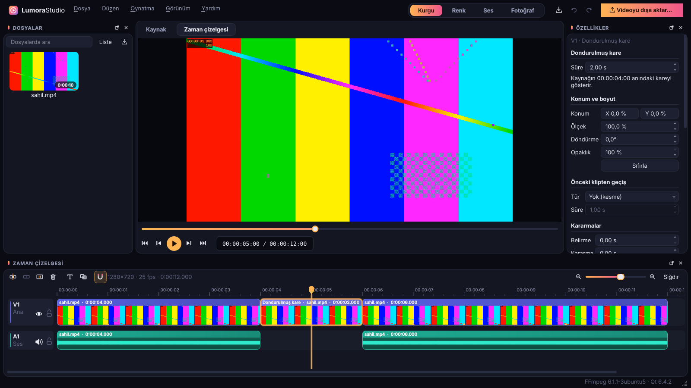

- Oynatma imlecini istediğiniz kareye getirin, **Düzen → Kareyi dondur…** (Shift+F ya da klibe sağ tık) ve süreyi saniye olarak yazın. O kare bu süre boyunca ekranda kalır, klibin geri kalanı ardından devam eder; sonraki her şey (bağlı ses, üst izlerdeki yazılar) birlikte kayar. Dondurma sırasında klibin kendi sesi susar.
- Dondurulmuş kare zaman çizelgesinde ayrı bir parçadır: süresi Özellikler panelinden ya da kenarından sürüklenerek değişir, rengi ayarlanabilir, geri alınabilir ve projeye kaydedilir.
- Kalite: bekletilen kare kaynağın kendi karesidir; "Kaynakla aynı" ve "Kayıpsız ara format" dokunulmayan kareleri doğrudan kaynaktan dönüştürür. Kayıpsız kesim (yeniden kodlamasız) yeni kare üretemediği için dondurulmuş kare varken bunun nedenini söyler.

## Sürüm 0.4'te neler var

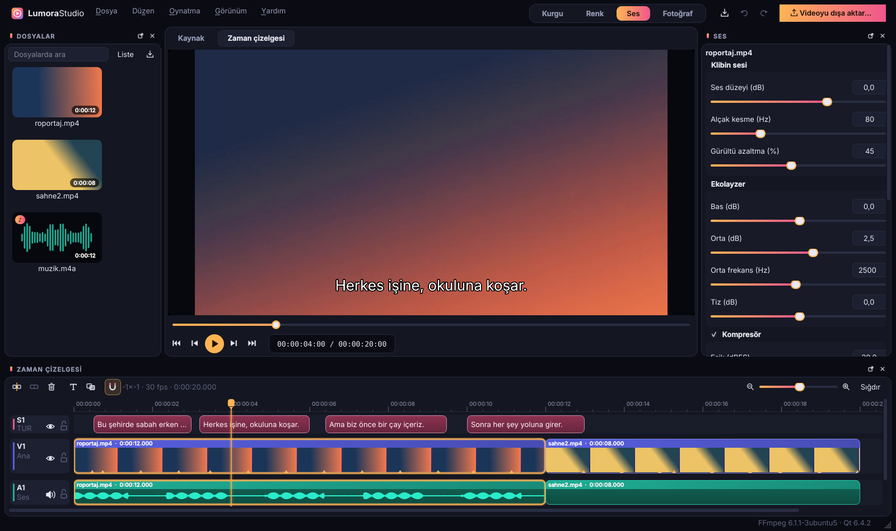

**Ses çalışma alanı**
- Üstteki **Ses** sekmesi: seçili klibin sesi ve tüm miksin ana çıkışı. Video klip seçiliyken ona bağlı ses düzenlenir.
- Klip başına: ses düzeyi, alçak kesme (uğultu ve rüzgâr), gürültü azaltma (sürekli arka plan gürültüsü; spektral, sözlere dokunmadan), üç bantlı ekolayzer, kompresör.
- **Kısma (ducking):** müzik klibi, başka klipler (ör. konuşma) çalarken kendiliğinden kısılır.
- **Ana çıkış:** dışa aktarırken ses yüksekliğini EBU R128'e göre ölçüp hedefe getirme (-14 LUFS YouTube/Spotify, -16 podcast, -23 TV) ve tepeleri tavanın altında tutan ileriye bakan limitleyici. **Ses yüksekliğini ölç** düğmesi miksin LUFS ve tepe değerini gösterir.
- Kalite ilkesi korunur: yalnızca ses değiştiyse görüntü yine bit bit kopyalanır, sadece ses yeniden karıştırılıp kodlanır.

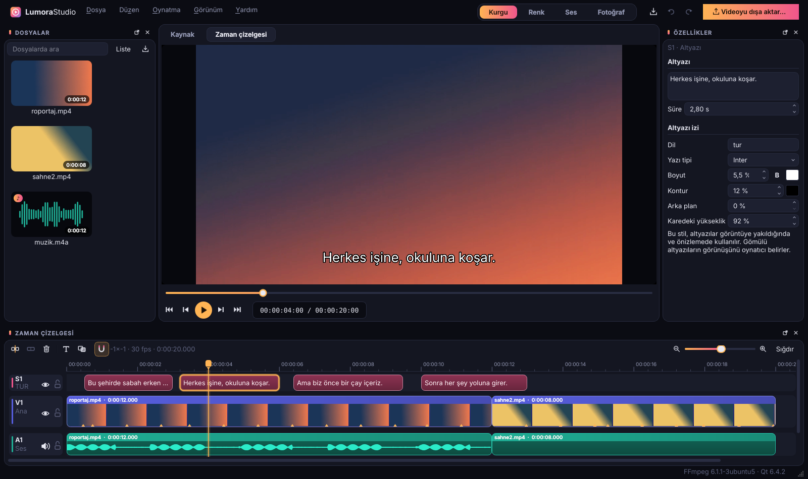

**Altyazı**
- Zaman çizelgesinin en üstünde altyazı izleri (S1, S2 …). Boş yere çift tıklama ya da Shift+T altyazı ekler; metin, süre, dil ve stil (yazı tipi, boyut, kontur, arka plan, yükseklik) Özellikler panelinde.
- **Düzen → Altyazılar:** SRT/VTT içe aktarma (UTF-8, UTF-16 ve eski Türkçe Windows-1254 dosyaları), SRT/VTT dışa aktarma.
- Dışa aktarırken üç seçenek: iz olarak göm (MP4/MOV'da mov_text, MKV'de SubRip, WebM'de WebVTT; açılıp kapatılabilir, kayıpsız kesim bozulmaz), görüntüye yak (hep görünür, yeniden kodlanır) ya da videonun yanına .srt olarak kaydet.

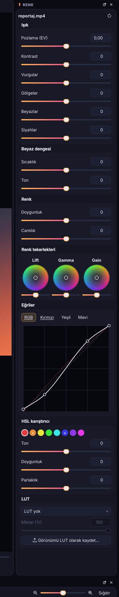

**Renk: eğriler ve HSL**
- Ton eğrileri: ana eğri ve kırmızı/yeşil/mavi ayrı ayrı. Tıklayıp nokta ekleme, sürükleme, çift/sağ tıklayıp silme. Eğri noktaların arasında taşmaz (monoton ara değerleme).
- HSL karıştırıcı: 8 renk aralığının her biri için ton, doygunluk, parlaklık. Gri tonlar ve diğer renkler yerinde kalır.
- Videoda ve fotoğrafta (ayar katmanları dahil) aynı hesap.

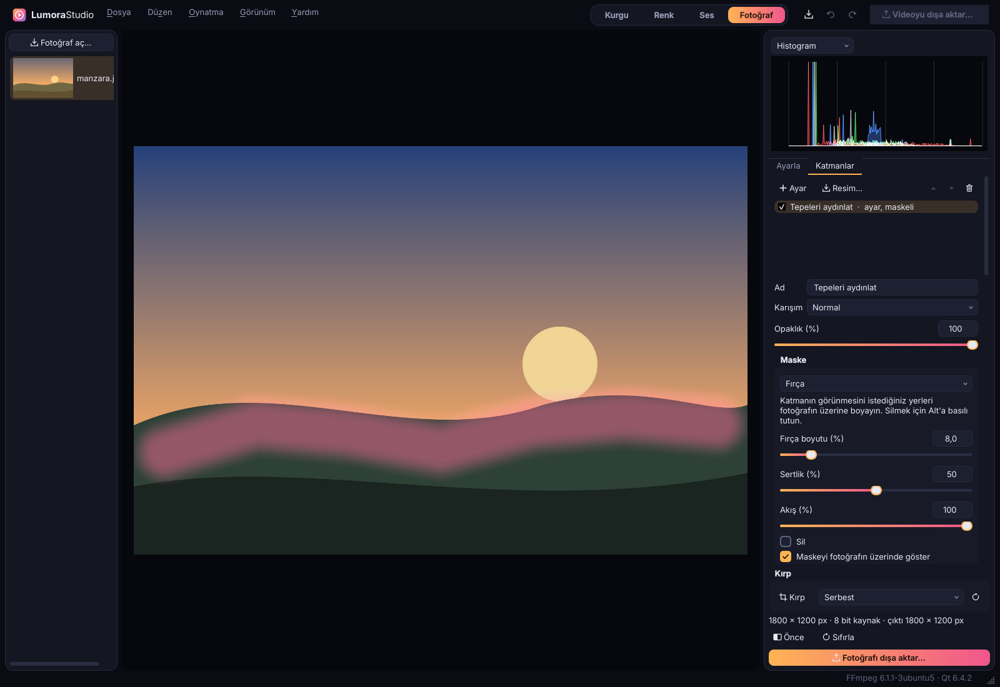

**Fotoğraf: fırça maskesi ve RAW**
- Ayar ve resim katmanlarına **Fırça** maskesi: fotoğrafın üzerine boyayın; boyut, sertlik, akış; Alt ile ya da **Sil** kutusuyla silme. Maske istenirse renkli olarak üstte gösterilir. Darbeler çözünürlükten bağımsız saklanır, önizleme ve tam boyutlu çıktı aynıdır.
- Kamera RAW dosyaları (CR2/CR3, NEF, ARW, RAF, ORF, RW2, PEF, DNG …) LibRaw ile açılır: kameranın beyaz dengesiyle, 16 bit sRGB olarak, vurguları kırpmadan. Küçük resimde dosyanın içindeki önizleme kullanılır.

**Düzeltme:** Güncelleme penceresi artık Ayarlar penceresinin arkasında açılmıyor.

## Sürüm 0.3'te neler var

**Renk çalışma alanı (video)**
- Üstteki **Renk** sekmesi: solda kapsamlar, ortada önizleme, sağda seçili klibin renk ayarları, altta zaman çizelgesi. Her çalışma alanı kendi panel düzenini hatırlar.
- Işık: pozlama, kontrast, vurgular, gölgeler, beyazlar, siyahlar. Beyaz dengesi: sıcaklık ve ton. Renk: doygunluk ve canlılık (zaten güçlü renklere ve ten rengine pek dokunmaz).
- Renk tekerlekleri: lift (gölgeler), gamma (orta tonlar), gain (parlak alanlar); her birinin altında parlaklık kaydırıcısı. Çift tıklama sıfırlar, Shift ince ayar yapar.
- LUT: .cube dosyaları (3B ve 1B), miktar kaydırıcısıyla. Son kullanılan LUT'lar listede durur. **Görünümü LUT olarak kaydet** o anki ayarları 33³'lük bir .cube dosyasına yazar; aynı görünüm başka kliplerde, fotoğraflarda ya da başka programlarda kullanılabilir.
- Kapsamlar: dalga formu, RGB parade, vektörskop (%75 renk hedefleri ve ten çizgisiyle), histogram. Oynatırken canlı güncellenir.
- Hesap her adımda 32 bit kayan noktada; pozlama, beyaz dengesi ve kontrast doğrusal ışıkta. Önizleme ve dışa aktarma aynı hesabı yapar, dışa aktarma 16 bit kanal başına. Renk ayarı olan klipler kayıpsız kesimle dışa aktarılamaz; bu, nedeniyle birlikte söylenir. Okunamayan bir LUT varsa dışa aktarma başlamadan durur, görünüm sessizce değişmez.

**Fotoğrafta renk, katmanlar ve maskeler**
- Fotoğraf çalışma alanında videodakiyle aynı renk paneli (**Ayarla** sekmesi) ve canlı histogram/kapsam.
- **Katmanlar** sekmesi: ayar katmanları (kendi renk ayarları olan, maskenin içinde etki eden katman) ve resim katmanları (üste başka bir resim; konum ve boyut). Her katmanda karışım modu (normal, çarp, ekran, kaplama, yumuşak ışık, koyulaştır, aydınlat, ekle, fark), opaklık, gizle/göster, sıralama.
- Maskeler: dikdörtgen, elips, degrade; yumuşaklık ve ters çevirme. Maskenin çerçevesi fotoğrafın üzerinde görünür, sürükleyerek taşınır.
- Orijinal dosya yine hiç değişmez. Katmanlar projede saklanır; 0.1/0.2 projeleri olduğu gibi açılır.

## Sürüm 0.2'de neler var

**Çok izli zaman çizelgesi**
- Ana iz (V1, mıknatıslı) üzerinde istediğiniz kadar video izi, altında istediğiniz kadar ses izi. İz başlığında gizle, sustur ve kilitle düğmeleri; sağ tık menüsünden iz ekleme ve kaldırma.
- Klipleri izler arasında sürükleme. Üst izlerdeki klipler ana izdeki klibe bağlıdır ve onunla birlikte kayar.
- Yalnızca ses içeren dosyalar (MP3, M4A, WAV, FLAC…) ses izine eklenir; müzik ve seslendirme için ayrı izler.

**Başlıklar, geçişler, dönüşüm**
- Başlık klipleri (T): metin, yazı tipi, boyut, kalın/italik, renk, hizalama, konum, kontur, arka plan, yumuşak gölge; giriş ve çıkış animasyonları (solma, yukarı kayma, belirme, daktilo).
- Geçişler (Ctrl+T): çapraz geçiş, siyaha/beyaza geçiş, dört yönde silme, sola/sağa itme, yakınlaştırma, bulanıklaştırma. Kesimin iki yanında yeterli görüntü yoksa bunu açıkça söyler.
- Her klipte konum, ölçek, döndürme ve opaklık (resim içinde resim), belirme/kararma, ses düzeyi (dB). Değerleri sürüklemek tek geri alma adımıdır.
- Önizleme ve dışa aktarma aynı birleştiriciyi kullanır; dışa aktarma 16 bit kanal başına ve Lanczos ölçekleme ile çalışır. Efekt içermeyen kareler kaynaktan doğrudan dönüştürülür.
- Ses karıştırıcı: birden çok iz, ses düzeyi, belirme/kararma ve geçişlerde eşit güçte çapraz geçiş.

**Dışa aktarma**
- Yeni **Özel** mod ve hazır ayarlar: YouTube 1080p / 4K, Instagram Reels ve akış, TikTok, X, arşiv (HEVC 10 bit), ProRes 422 HQ, DNxHR HQ.
- Kodekler: H.264, HEVC, AV1, VP9, ProRes, DNxHR, FFV1. Kodlayıcılar: x264, x265, SVT-AV1, libaom, libvpx ve bilgisayarda gerçekten çalışan donanım kodlayıcıları (NVIDIA NVENC, Intel Quick Sync, AMD AMF, Apple VideoToolbox).
- Kalite modu: sabit kalite, değişken bit hızı (en yüksek bit hızıyla), sabit bit hızı, hedef dosya boyutu; iki geçişli kodlama. Kare boyutu (siyah bantlı ya da bantsız sığdırma), kare hızı, bit derinliği, kodlama hızı, ses kodeği ve bit hızı.
- Zaman çizelgesinde başlık, geçiş ya da efekt varsa "Kayıpsız kesim" kendiliğinden kapanır ve nedeni yazılır.
- Geçerli kareyi 16 bit PNG ya da TIFF olarak dışa aktarma (Ctrl+Alt+S).

## Sürüm 0.1'de neler var

**Video**
- MP4, MOV, MKV, WebM, AVI, MXF, TS dosyalarını açma; küçük resim, ses dalga formu ve anahtar kare taraması arka planda.
- Kaynak ve zaman çizelgesi önizlemesi, sesli oynatma, kare kare ilerleme, giriş/çıkış (I/O) noktaları.
- Mıknatıslı zaman çizelgesi (V1 + bağlantılı A1): ekleme, bölme, silme (boşluk kapanır), kırpma, taşıma, aynı dosyanın ardışık parçalarını yeniden birleştirme, yakınlaştırma ve yapışma.
- Klip özelliklerinde "kayıpsız kesim" göstergesi: klip bir anahtar karede mi başlıyor?

**Dışa aktarma**
- **Kayıpsız kesim (önerilen):** video ve ses yeniden kodlanmadan kopyalanır. Kesimler anahtar karelere oturur; B-kareli videolarda hiçbir bozuk kare yazılmaz. "Kesimleri anahtar karelere hizala" ile zaman çizelgesi tam olarak çıkacak sonucu gösterir.
- **Kaynakla aynı:** kare hassasiyetinde kesim; kaynağın kodeği, çözünürlüğü, kare hızı, piksel biçimi, renk bilgileri ve bit hızıyla yeniden kodlar. Ses uyumluysa kopyalanır.
- **Kayıpsız ara format:** FFV1 (MKV), kare hassasiyetinde ve matematiksel olarak kayıpsız.
- Dışa aktarmadan önce "Ne olacak" listesi neyin kopyalanıp neyin kodlanacağını açıkça söyler; kalite hiçbir zaman sessizce düşürülmez.

**Fotoğraf**
- JPEG, PNG, TIFF, WebP (8 ve 16 bit) açma.
- Kırpma (serbest ve hazır oranlar), pozlama, kontrast, beyaz dengesi (sıcaklık ve ton), önce/sonra karşılaştırması.
- Doğrusal ışıkta 32 bit kayan nokta işleme, 16 bit saklama; ICC renk profili korunur.
- Kayıpsız kaydetme: PNG veya TIFF. Ayar yapılmadıysa pikseller birebir yazılır. JPEG/WebP isteğe bağlıdır ve kayıplı olduğu açıkça yazar.

**Genel**
- Sınırsız geri al / yinele (video ve fotoğraf için ayrı geçmiş).
- `.lumora` proje dosyası (okunabilir JSON; göreli ve mutlak yollar, eksik medya listesi).
- Türkçe ve İngilizce arayüz (Görünüm → Dil), kendine özgü "Gece" (koyu) ve "Gündüz" (açık) tema, taşınabilir paneller.

Bilinçli olarak sonraki sürümlere bırakılanlar: EXIF meta verisinin fotoğrafa geri yazılması, anahtar karelerle animasyon, dışa aktarma kuyruğu.

## Klavye kısayolları

| Tuş | İşlem |
|---|---|
| Boşluk | Oynat / duraklat |
| ← / → | Önceki / sonraki kare |
| Home / End | Başa / sona git |
| I / O | Giriş / çıkış noktası |
| E | Kaynak aralığını zaman çizelgesine ekle |
| T | Oynatma kafasına başlık ekle |
| Ctrl+T | Seçili klibe ya da en yakın kesime geçiş ekle |
| Ctrl+Alt+S | Geçerli kareyi dışa aktar |
| S veya Ctrl+B | Oynatma kafasından böl |
| Del | Klibi sil (boşluğu kapat) |
| Ctrl+J | Sonraki kliple birleştir |
| N | Yapışmayı aç/kapat |
| + / − | Yakınlaştır / uzaklaştır |
| Ctrl+I / Ctrl+E | Medya içe aktar / videoyu dışa aktar |
| Ctrl+Z / Ctrl+Shift+Z | Geri al / yinele |
| C / \\ | Fotoğrafta kırpma / önce-sonra |

## Derleme

Gerekenler:

- CMake 3.21+, C++20 derleyici (Windows'ta Visual Studio 2022, Linux'ta GCC 11+ ya da Clang 14+)
- Qt 6.4+ : Core, Gui, Widgets, Concurrent, Multimedia, LinguistTools (testler için Test). WebP/TIFF için Qt Image Formats eklentisi önerilir.
- FFmpeg 6.1 – 8.x kütüphaneleri: avformat, avcodec, avutil, swscale, swresample

### Windows

1. **Visual Studio 2022**'yi "Desktop development with C++" iş yüküyle kurun (CMake ve Ninja onunla gelir).
2. **Qt 6**'yı kurun. [Qt Online Installer](https://www.qt.io/download-qt-installer-oss) ile *Qt 6.8 → MSVC 2022 64-bit* ve *Additional Libraries → Qt Multimedia, Qt Image Formats* seçin. Ya da komut satırından:
   ```powershell
   pip install aqtinstall
   aqt install-qt windows desktop 6.8.3 win64_msvc2022_64 -m qtmultimedia qtimageformats -O C:\Qt
   ```
3. **FFmpeg**'i indirin: [BtbN FFmpeg-Builds](https://github.com/BtbN/FFmpeg-Builds/releases/tag/latest) sayfasından `ffmpeg-n8.1-latest-win64-gpl-shared-8.1.zip` dosyasını alıp örneğin `C:\deps\ffmpeg` klasörüne açın (`include`, `lib`, `bin` klasörleri orada olmalı).
4. İsteğe bağlı, RAW fotoğraflar için **LibRaw**: [vcpkg](https://vcpkg.io) ile `vcpkg install libraw:x64-windows`, sonra aşağıdaki `cmake` satırına `-DCMAKE_TOOLCHAIN_FILE=C:\vcpkg\scripts\buildsystems\vcpkg.cmake` ekleyin ve `C:\vcpkg\installed\x64-windows\bin` içindeki DLL'leri programın yanına koyun. LibRaw olmadan da derlenir; yalnızca RAW dosyaları açılmaz.
5. "x64 Native Tools Command Prompt for VS 2022" penceresinde:
   ```bat
   git clone https://github.com/highlvmami/LumoraStudio.git
   cd LumoraStudio
   cmake -S . -B build -G Ninja -DCMAKE_BUILD_TYPE=Release ^
         -DCMAKE_PREFIX_PATH=C:\Qt\6.8.3\msvc2022_64 -DFFMPEG_ROOT=C:\deps\ffmpeg
   cmake --build build
   ```
   Derleme sonunda FFmpeg DLL'leri otomatik olarak `build\src\app` içine kopyalanır.
6. Çalıştırmak ya da başka bir bilgisayara taşımak için Qt DLL'lerini yanına koyun:
   ```bat
   C:\Qt\6.8.3\msvc2022_64\bin\windeployqt.exe --release build\src\app\LumoraStudio.exe
   build\src\app\LumoraStudio.exe
   ```

Hazır derlenmiş paket: her PR ve `main` için GitHub Actions'ta **Build** iş akışı çalışır; `LumoraStudio-windows-x64` çıktısını indirip açtığınızda `LumoraStudio.exe` doğrudan çalışır.

### Linux (Ubuntu 24.04)

```bash
sudo apt install build-essential cmake ninja-build pkg-config \
  qt6-base-dev qt6-multimedia-dev qt6-tools-dev qt6-tools-dev-tools qt6-l10n-tools \
  qt6-image-formats-plugins libgl-dev \
  libavformat-dev libavcodec-dev libavutil-dev libswscale-dev libswresample-dev \
  libraw-dev
cmake -S . -B build -G Ninja -DCMAKE_BUILD_TYPE=Release
cmake --build build
./build/src/app/LumoraStudio
```

Başka bir FFmpeg kullanmak için `-DFFMPEG_ROOT=/yol/ffmpeg` verin; verilmezse pkg-config kullanılır. LibRaw isteğe bağlıdır: yoksa program yine derlenir, yalnızca RAW dosyaları listelenmez.

### macOS

Kod taşınabilir yazıldı ama 0.1'de macOS derlemesi denenmedi. `brew install qt ffmpeg cmake ninja` sonrasında Linux'taki komutlar çalışmalıdır.

## Çalıştırma

```bash
LumoraStudio                     # boş proje
LumoraStudio proje.lumora        # proje aç
LumoraStudio video.mp4 foto.jpg  # dosyaları içe aktararak başla
```

Dil, Görünüm → Dil menüsünden seçilir (yeniden başlatınca geçerli olur); seçilmezse sistem dili kullanılır.

## Testler

```bash
cmake --build build
QT_QPA_PLATFORM=offscreen ctest --test-dir build --output-on-failure
```

Testler kendi deneme videolarını üretir (her kare kendi numarasını taşır) ve şunları doğrular: kayıpsız kesimde paketlerin bit bit aynı olması, "kaynakla aynı"da kare hassasiyeti, FFV1'de piksel piksel eşitlik, B-kareli H.264 kesimlerinde hiç çözme hatası olmaması, zaman çizelgesi işlemleri, fotoğraf işleme ve proje dosyasının gidiş-dönüşü. 0.2 ile eklenenler: başlık, geçiş ve karıştırılmış sesli zaman çizelgesinin işlenmesi, özel ayarlarda her karenin korunması, ölçekleme ve kare hızı değişimi, bit hızı modlarının hedefi tutturması, ProRes/DNxHR çıktısı, her hazır ayarın planlanabilmesi ve diğer kodlayıcıların tek ve iki geçişte çalışması. 0.3 ile eklenenler: renk ayarlarının her birinin doğru aralığa etki etmesi, .cube okuma (3B/1B, hatalı dosyalar) ve yazma, kaydedilen LUT'un aynı görünümü vermesi, kapsamlar, maskeli ayar katmanları ve resim katmanlarında karışım modları, klip renginin önizlemede ve dışa aktarmada aynı işlenmesi. 0.4 ile eklenenler: EBU referans tonlarıyla ses yüksekliği ölçümü, limitleyicinin tavanı hiç aşmaması, gürültü azaltmanın sinyale dokunmayıp gürültüyü düşürmesi ve gecikmesinin tam olması, ekolayzer, kısma, eşitlemenin hedefi tutturması, ses efektleriyle dışa aktarmada görüntünün bit bit kopyalanması, altyazının gömülmesi/yakılması/.srt olarak kaydedilmesi, SRT/VTT okuma-yazma, eğriler, HSL, fırça maskesi ve RAW (üretilen bir DNG ile) açma. 0.6 ile eklenenler: yüz/plaka bölgelerinin kareler arasında doğru doldurulması ve proje dosyasında korunması, takipçinin kareden kareye eşleştirmesi (kısa kayıplar dahil), bulanıklaştırma/pikselleştirme/siyah kutunun bölge dışına dokunmaması, çizicinin bölgeleri önizlemede ve dışa aktarmada aynı gizlemesi, saydamlık maskesi; modeller varken (`LUMORA_VISION_MODELS`) gerçek bir fotoğrafta ve hareket eden bir videoda yüz bulma, plaka bulma ve arka plan kaldırma.

## Proje yapısı

```
src/core/        Arayüzden bağımsız çekirdek (lumora_core kütüphanesi)
  TimeBase.*       Tamsayı zaman tabanı (1/705 600 000 sn), kare hızı yardımcıları
  ffmpeg/          FFmpeg için RAII sarmalayıcılar
  media/           Medya bilgisi, anahtar kare taraması, video/ses çözücüler, medya havuzu
  timeline/        Zaman çizelgesi modeli (izler, klipler, bağlantılar, başlık/geçiş/dönüşüm ayarları), SRT/VTT altyazı okuma/yazma
  render/          Kare birleştirici (FrameRenderer), başlık çizici, ses karıştırıcı
  audio/           Ses efektleri (filtreler, gürültü azaltma, kompresör, limitleyici), EBU R128 ses yüksekliği ölçümü
  color/           Renk ayarları (ColorGrade, eğriler, HSL), renk hattı (ColorProcessor), .cube LUT okuma/yazma, kapsamlar
  undo/            Geri al / yinele komutları
  export/          Dışa aktarma planlayıcı (ne kopyalanır, ne kodlanır), kodlayıcı tablosu ve hazır ayarlar, kopyalayan ve işleyen dışa aktarıcılar
  ai/              Yerel yapay zeka: Whisper konuşma tanıma, ONNX Runtime ile yüz/plaka bulma ve takip, arka plan kaldırma
  motion/          Hareket analizi: sabitleme ve nesne takibi
  image/           Fotoğraf ayarları ve katmanları, işleme hattı, fotoğraf kütüphanesi, RAW okuyucu (LibRaw)
  project/         .lumora proje dosyası
src/app/         Qt Widgets arayüzü: ana pencere, paneller, oynatma motoru, pencereler
src/i18n/        Çeviriler (lumora_tr.ts)
tests/           Qt Test birim testleri
docs/            Özellik listesi, mimari, ekran görüntüleri
```

Çeviriyi güncellemek için: `cmake --build build --target update_translations`, sonra `src/i18n/lumora_tr.ts` dosyasını Qt Linguist ile düzenleyin.

## Lisans notu

Yapay zeka araçları ONNX Runtime (MIT) ile çalışır; Windows paketinde onnxruntime.dll olarak gelir. Modeller programla dağıtılmaz, ilk kullanımda kendi yayınlandıkları yerden indirilir (lisansları yukarıda).

Arayüzde kullanılan Inter yazı tipi programın içine gömülüdür ve SIL Open Font License 1.1 ile dağıtılır (`src/app/resources/fonts/OFL.txt`).

Henüz bir lisans dosyası eklenmedi; projenin lisansına siz karar vermelisiniz. Windows paketi BtbN'in GPL FFmpeg derlemesini kullanır (x264 vb. içerir), bu yüzden dağıtılan paket GPL koşullarına tabidir. LGPL istenirse `lgpl-shared` derlemesi kullanılabilir; o durumda H.264 kodlama için başka bir kodlayıcı gerekir.
